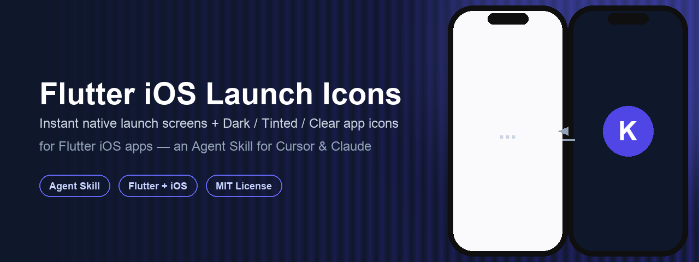
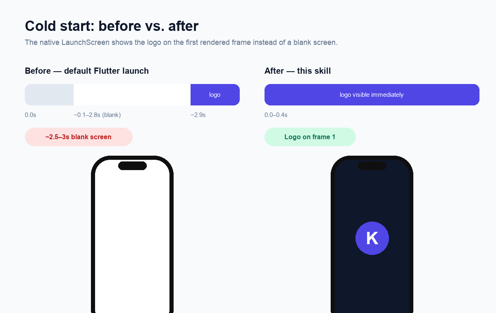
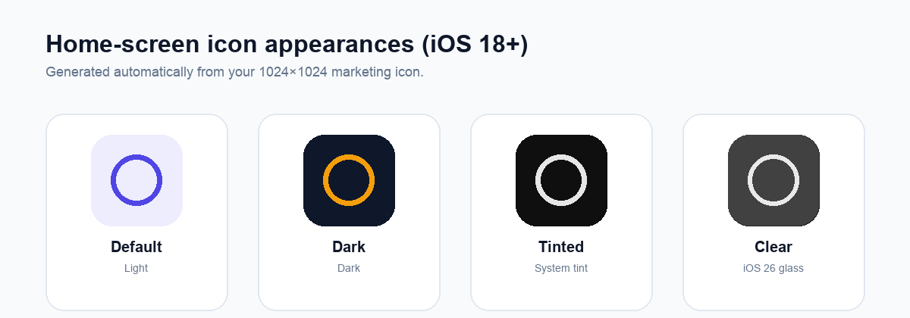

<div align="center">



# Flutter iOS Launch Icons

**An [Agent Skill](https://agentskills.io) that gives Flutter iOS apps an instant native launch logo and full Dark / Tinted / Clear home-screen icon support — in minutes, not hours of trial and error with Xcode storyboards.**

[](LICENSE)
[](skills/flutter-ios-launch-icons/SKILL.md)
[](#)
[](CONTRIBUTING.md)

[What it fixes](#-what-it-fixes) ·
[Install](#-install) ·
[Usage](#-usage) ·
[How it works](#%EF%B8%8F-how-it-works) ·
[Troubleshooting](#-troubleshooting) ·
[Contributing](#-contributing)

</div>

---

## 😩 The problem

Every Flutter iOS app ships with a default `LaunchScreen.storyboard`. Because Flutter does a lot of work before `runApp()` (Firebase, Hive/Hydrated storage, DI, font preloading…), that storyboard can sit on screen for **2–3+ seconds** — usually as a blank white or off-white rectangle — before your Flutter splash even has a chance to paint.

On top of that, iOS 18+ introduced **Dark**, **Tinted**, and **Clear** home-screen icon appearances. Most Flutter apps still ship a single flat icon that never changes, even when the user explicitly picks "Dark" in the Home Screen customization sheet.

## ✅ What it fixes



- **Native launch logo on frame 1** — no more blank white/ivory flash before Flutter boots.
- **Light + Dark launch variants** that follow the **system** appearance automatically (not your in-app theme toggle).
- **Home-screen icon appearances** — Default, Dark, Tinted, and Clear — generated from your existing 1024×1024 marketing icon.



> Clear is derived by iOS from the Tinted artwork — there's nothing extra to design or export for it.

## 📦 What's inside

This repository is a single [Agent Skill](https://agentskills.io) — a portable `SKILL.md` playbook plus two ready-to-run Python scripts — that an AI coding agent (Cursor, Claude Code, or any `npx skills`–compatible agent) reads and executes against **your** Flutter iOS project.

```
flutter-ios-launch-icons/
├── README.md
├── LICENSE
├── CONTRIBUTING.md
├── docs/
│   └── images/                      # README screenshots
└── skills/
    └── flutter-ios-launch-icons/
        ├── SKILL.md                 # the agent playbook (start here)
        ├── references/
        │   ├── launch-storyboard.md # full LaunchScreen.storyboard XML template
        │   └── appicon-contents.md  # AppIcon Contents.json appearance shapes
        └── scripts/
            ├── generate_launch_logos.py        # light/dark launch PNGs
            └── generate_app_icon_variants.py   # dark/tinted 1024 icon PNGs
```

## 🚀 Install

### Option A — via the Skills CLI (recommended)

```bash
npx skills add haithemnini/flutter-ios-launch-icons
```

This drops the skill into your agent's skills directory (e.g. `.cursor/skills/`) so it's automatically discoverable the next time you ask about launch screens or app icons.

### Option B — manual

```bash
git clone https://github.com/haithemnini/flutter-ios-launch-icons.git
cp -R flutter-ios-launch-icons/skills/flutter-ios-launch-icons ~/.cursor/skills/
```

Or for a single project only, drop it under `.cursor/skills/` at the repo root.

## 🧭 Usage

Open your Flutter project in Cursor (or any agent that supports Agent Skills) and ask something like:

> "My iOS app shows a blank white screen on cold start — fix it with the `flutter-ios-launch-icons` skill, and also make the home screen icon support Dark/Tinted mode."

The agent will read [`SKILL.md`](skills/flutter-ios-launch-icons/SKILL.md) and follow its checklist:

```
Progress:
- [ ] 1. Generate light + night launch PNGs (@1x/@2x/@3x)
- [ ] 2. Copy into ios/Runner/ and add to Copy Bundle Resources (pbxproj)
- [ ] 3. Remove any BrandLogo*.imageset from Assets.xcassets
- [ ] 4. Update LaunchScreen.storyboard (loose image names + explicit colors)
- [ ] 5. Optional: LaunchBackground.colorset for Main.storyboard / SceneDelegate handoff only
- [ ] 6. Generate AppIcon dark + tinted 1024 (and home sizes if keeping legacy entries)
- [ ] 7. Update AppIcon.appiconset/Contents.json with luminosity dark + tinted
- [ ] 8. flutter build ios --simulator --debug
- [ ] 9. simctl uninstall + install; verify launch <0.5s and icon appearances in Assets.car
```

### Running the scripts yourself

You don't need an agent to benefit from the generation scripts — they're plain Python + Pillow and work standalone:

```bash
pip install pillow

# 1. Generate light + dark launch logos from your source artwork
python3 skills/flutter-ios-launch-icons/scripts/generate_launch_logos.py \
  assets/logo/logo.png \
  --out ios/Runner \
  --gold E0B45D \
  --width 400 --height 363

# 2. Generate Dark + Tinted 1024 App Icon variants from your existing light icon
python3 skills/flutter-ios-launch-icons/scripts/generate_app_icon_variants.py \
  ios/Runner/Assets.xcassets/AppIcon.appiconset/Icon-App-1024x1024@1x.png \
  --out ios/Runner/Assets.xcassets/AppIcon.appiconset \
  --plate 17120E --gold-deep C9953E --gold-light F8E7C0 \
  --home-sizes
```

Then follow [`SKILL.md`](skills/flutter-ios-launch-icons/SKILL.md) Steps 2–6 to wire the generated PNGs into your storyboard, Xcode project, and `Contents.json`.

## ⚙️ How it works

| Problem | Root cause | Fix |
|---|---|---|
| Blank screen for seconds | `UIImage imageNamed:` from an Asset Catalog often fails on the **very first** `SplashBoard` snapshot | Ship the logo as **loose PNGs** in the app bundle, not an `.imageset` |
| Dark logo doesn't switch | Named colors / catalog luminosity appearances aren't reliably honored by the launch snapshot | Use storyboard `variation key="userInterfaceStyle=dark"` with **explicit sRGB** colors |
| Home icon stays light in Dark mode | Legacy per-size `Contents.json` has no `appearances` entries | Add `luminosity: dark` / `luminosity: tinted` entries pointing at generated 1024 PNGs |
| Generator (`flutter_launcher_icons`) wipes the fix | It regenerates `Contents.json` from a single source image | Stop running it for iOS once appearances are added, or re-patch after each run |

Full technical rationale, the exact storyboard trait keys that work vs. silently fail, and verification commands (`actool`, `assetutil`, `simctl`) live in [`SKILL.md`](skills/flutter-ios-launch-icons/SKILL.md) and the [`references/`](skills/flutter-ios-launch-icons/references/) folder.

## 🎨 Brand defaults

The scripts ship with sensible defaults you should override for your own brand:

| Token | Default | Flag |
|---|---|---|
| Dark launch logo color | `#E0B45D` | `--gold` |
| Launch logo size (@1x) | 400×363 | `--width` / `--height` |
| Dark icon plate color | `#17120E` | `--plate` |
| Icon gold gradient | `#C9953E` → `#F8E7C0` | `--gold-deep` / `--gold-light` |

## 🧪 Verifying on a simulator

```bash
flutter build ios --simulator --debug
xcrun simctl uninstall booted <your.bundle.id>
xcrun simctl install booted build/ios/iphonesimulator/Runner.app

# Confirm the launch logos are loose files, not in the asset catalog:
xcrun assetutil --info build/ios/iphonesimulator/Runner.app/Assets.car | grep -i BrandLogo || echo "not in catalog — correct"

# Confirm the icon catalog has dark + tinted renditions:
xcrun assetutil --info build/ios/iphonesimulator/Runner.app/Assets.car | grep -E 'UIAppearanceDark|ISAppearanceTintable'
```

## 🛠 Troubleshooting

<details>
<summary><strong>The launch screen is still blank for a few seconds</strong></summary>

You likely still have a `BrandLogo.imageset` in `Assets.xcassets`. Delete it — the catalog image silently wins over the loose PNG and fails to load on the first `SplashBoard` snapshot. Rebuild with `flutter build ios --simulator --debug` and reinstall (delete the app from the simulator/device once to clear the cached blank snapshot).
</details>

<details>
<summary><strong>The dark launch logo never appears</strong></summary>

Check your storyboard uses `<variation key="userInterfaceStyle=dark" image="BrandLogoNight"/>`. The keys `interfaceStyle` and `luminosity=dark` either get ignored or crash `ibtool` — see [`references/launch-storyboard.md`](skills/flutter-ios-launch-icons/references/launch-storyboard.md).
</details>

<details>
<summary><strong>The home screen icon doesn't change in Dark/Tinted mode</strong></summary>

1. Confirm `Contents.json` has `appearances` entries pointing at your generated `-dark.png` / `-tinted.png` files (see [`references/appicon-contents.md`](skills/flutter-ios-launch-icons/references/appicon-contents.md)).
2. Make sure you haven't re-run `flutter_launcher_icons` afterward — it overwrites `Contents.json`.
3. Delete the app from the home screen and reinstall; SpringBoard caches the old icon.
</details>

<details>
<summary><strong>I swapped the storyboard with ibtool directly and got a black flash</strong></summary>

Never verify by copying a standalone-compiled `storyboardc` into an already-built `.app`. Always run a full `flutter build ios --simulator` (or device build) so the storyboard is compiled and signed as part of the real build.
</details>

## 🤝 Contributing

Issues and PRs are welcome — see [CONTRIBUTING.md](CONTRIBUTING.md). If you use this skill on a real app, a before/after screenshot in your PR or issue is always appreciated.

## 📄 License

[MIT](LICENSE) — use it, fork it, ship it.

---

<div align="center">
<sub>Built as a reusable <a href="https://agentskills.io">Agent Skill</a> for Cursor, Claude Code, and other agent-skills-compatible tools.</sub>
</div>
